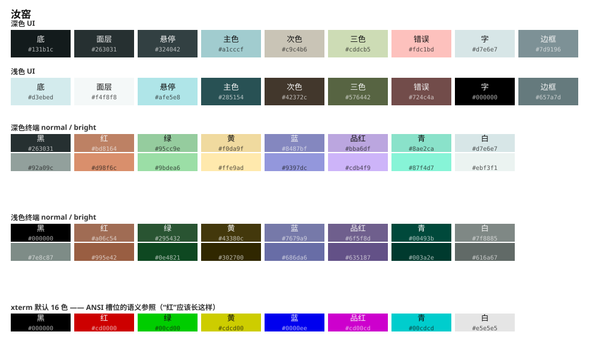
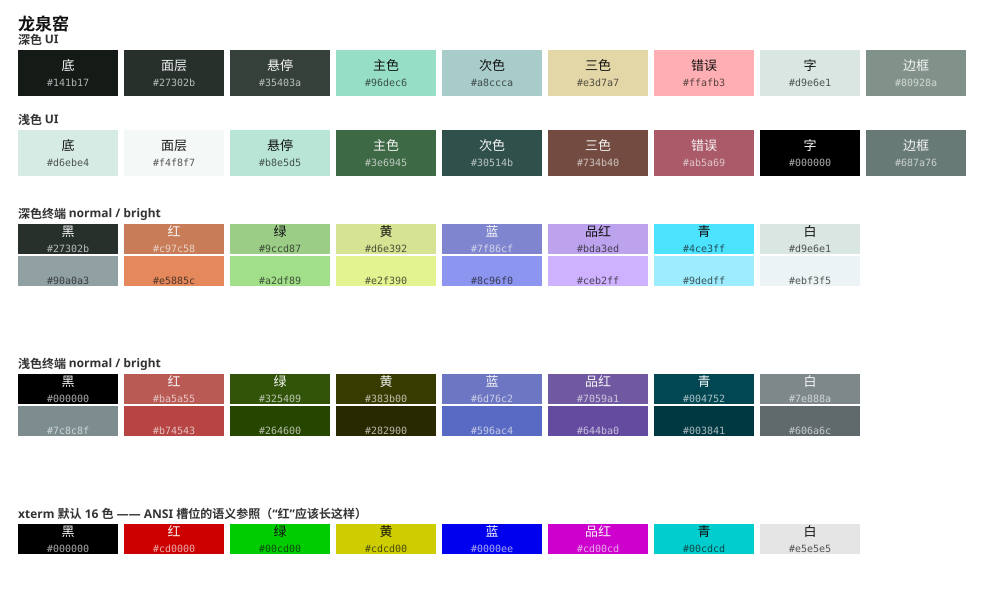
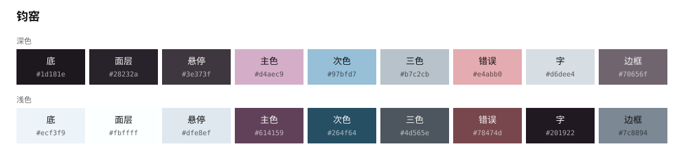
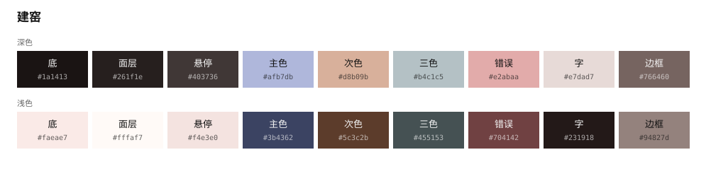
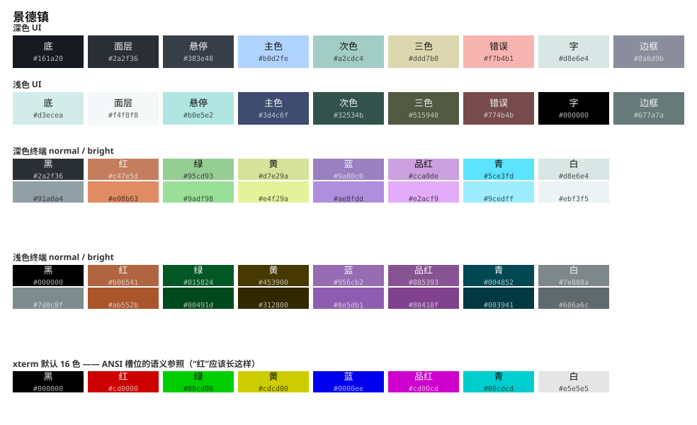
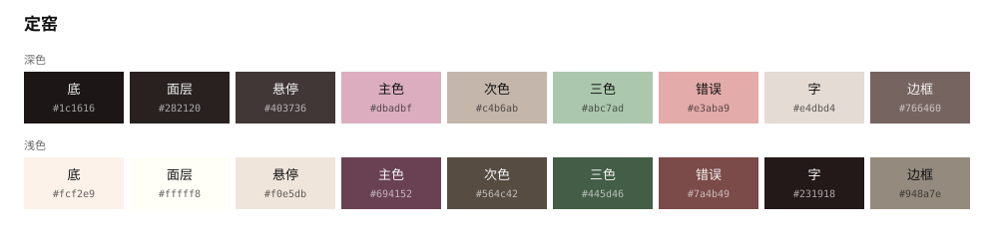
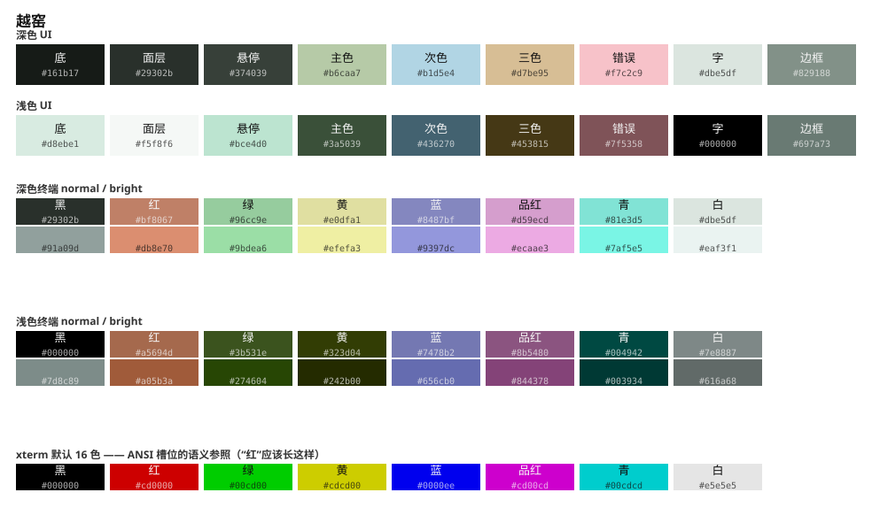
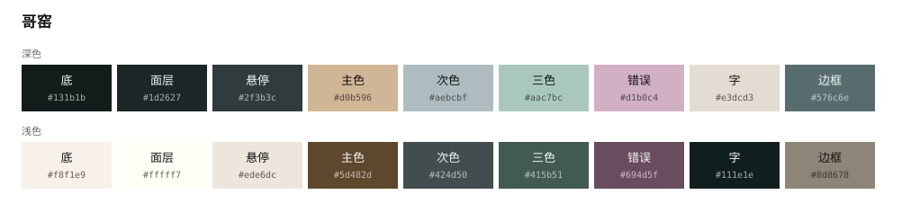
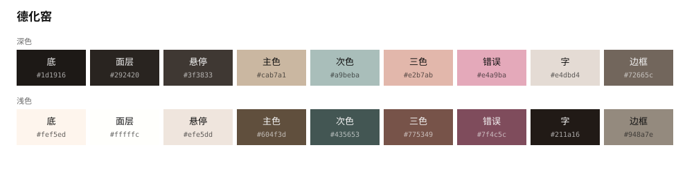
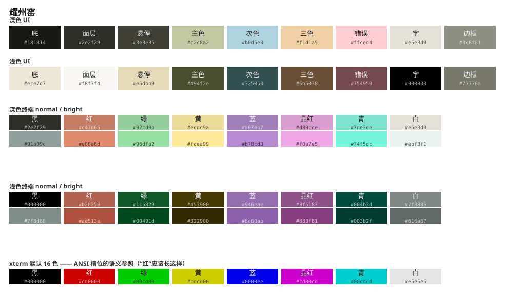

# 中华瓷窑调色板 · Chinese Kiln Palettes

十套取自中国古代名窑釉色的配色方案，用于 [Noctalia](https://noctalia.dev) 桌面外壳。每套**同时提供深色与浅色模式**。

所有色值都经过 **APCA（WCAG 3 草案算法）+ WCAG 2.x + CIEDE2000 + 色觉障碍模拟** 四重机器校验——不是"看起来还行"，是可复现的数值达标。

> **2026-10 修订**：初版校验只覆盖对比度和 6 个颜色的色相角，因此漏掉了一整类缺陷。
> 一次针对真机的审计发现：终端 16 色里有 **67% 的槽位名不副实**（`green` 是紫色、
> `blue` 是褐色），浅色模式的面层与底色在真机上 **APCA Lc = 0.0**（完全不可分辨），
> 悬停态在浅色下只有 **ΔE00 1.5**（低于 JND）。这些都已修正，校验规则也从 2 类扩到 12 类。
> 详见下方[校验](#校验)与[修订记录](#修订记录)。

```
python3 tools/verify.py       # 退出码 0=全过 / 2=仅软裕度警告 / 1=有失败
python3 tools/verify.py -v    # 带明细
```

校验分**硬约束**（不达标即失败）与**软裕度**（感知分离余量，不达标记警告）两层。
软裕度目前集中在终端 ANSI 的相邻色相槽（`green~cyan`、`green~yellow`），
量级都在门限的 85–99%；这是"浅底终端要保 WCAG + 要满足色相间距规则 + 要拉大红绿明度差"
三者共同挤压的结果。具体条数以 `-v` 的实时输出为准（**这里不写死数字** —— 之前手抄
的输出连续三轮和实况漂移，所以现在只留命令）。

---

## 安装

把 `palettes/` 里的 JSON 复制到 Noctalia 的调色板目录：

```bash
mkdir -p ~/.config/noctalia/palettes
cp palettes/*.json ~/.config/noctalia/palettes/
```

切换（即时生效，无需重载）：

```bash
noctalia msg color-scheme-set custom 汝窑
```

或在 `~/.config/noctalia/settings.toml` 里写死：

```toml
[theme]
source         = "custom"
custom_palette = "汝窑"
```

> 文件名是中文，Noctalia 可以正常加载（已端到端验证：生成的 starship / alacritty / fcitx5 主题文件里确实是调色板的色值，没有静默回退到内置调色板）。

---

## 设计方法

### 一、先定性格，再解色号

传统色的色值是按**颜料与釉色**记录的，不是按屏幕发光定的，直接拿来用必然失败。实测（放在深色底 `#131b1c` 上）：

| 传统色 | 原值 | APCA Lc | 问题 |
|---|---|---|---|
| 宝蓝 | `#4b5cc4` | −21.9 | 远低于内容文本线 60 |
| 天水碧 | `#5AA4AE` | −46.1 | 同上 |
| 松花 | `#ffee6f` | −94.1 | **超过暗色模式上限 −90**，会光晕 |

所以流程是：**描述色彩性格 → 翻译成感知参数（色相角 / 彩度 / 明度）→ 反解出满足工效学约束的色号**。

以**汝窑天青**为例：

| 文献性格 | 翻译成 | 结果 |
|---|---|---|
| "雨过天晴" | 色相在蓝绿之间偏蓝（h_ab 205°），不是纯蓝 | `#96c1c4` |
| "浅蓝" | 明度高，是暗色模式里最亮的元素 | Lc −63 |
| "透亮" | **彩度必须极低**——彩度高就变成颜料，不是釉 | **C\*ab 14.8**（十窑最低） |
| "宁静" | 底色同源、同样低彩度 | 底 `#131b1c`（h_ab 210°） |

**浅色模式下天青本身是背景**（`#e2f6f7`），不是强调色——"雨过天晴"是天空，天是地，不是字。

### 二、量化约束

| # | 约束 | 取值 | 依据 |
|---|---|---|---|
| R1 | 正文对比度（含**极性**） | 暗色 **−75 ~ −92**，浅色 **+85 起**；面层/悬停层按各层可达上限 | APCA 正文下限 75；暗色上限防光晕（代码 −92，实测最高 88.7） |
| R2 | 内容文本（强调色、次要文本、`on_*`） | **\|Lc\| ≥ 60** | APCA 内容文本线 |
| R3 | 交互控件边框 | **WCAG ≥ 3:1**，且**对底色 / 面层 / 悬停三者都成立** | WCAG 1.4.11 非文本对比度 |
| R4 | 强调色两两可分 | **ΔE00 ≥ 10**（错误色对其它 **≥ 14**）且色相间距 ≥ 22° | CIEDE2000；ΔE00≥10 即"明显不同色" |
| R5 | `mError` 语义 | 色相必须落在**危险红族 5°–40°** | "错误"是功能色，不是装饰色 |
| R6 | 终端 ANSI 色相锚定 | 硬槽（red/green/yellow/blue）**±15°**，软槽 **±30°**，彩度有下限 | 锚点 = xterm 默认 16 色的 CIELAB `h_ab` |
| R7 | 终端**全部 16 色**（含 bright） | **彩槽**：暗色 WCAG ≥ 4.5、浅色 ≥ 3.0；**无彩槽**分「文字槽」（`\|Lc\| ≥ 45`）与「背景槽」（与底色 WCAG ≥ 1.10，它本就该贴近底色） | 对照：Solarized Light 实测最低 2.93:1 |
| R8 | `bright` 组 | **仅对 6 个彩槽**要求 \|Lc\| 高于 `normal`；彩度按**各自的色域上限**判（`C(bright) ≥ 0.8 × min(C(normal), 该处色域上限)`）—— 高 \|Lc\| 下 sRGB 装不下同彩度是物理事实，实测 28/120 个彩槽的 bright 彩度确实低于 normal。`black`/`white` 是无彩槽，浅色下 `black` 是文字色而 `bright.black` 是更淡的灰，语义相反故不套此规则 | 浅色模式下"更醒目"= 更暗 |
| R9 | 底色 | 不用纯黑／纯白 | 避免光晕，保留层级空间 |
| R10 | 骨架层次 | 面层/悬停 vs 底色 **ΔE00 ≥ 6** | ≈2.6× JND；真机实测初版只有 3.3 |
| R11 | 色觉障碍 | protan/deutan 下 `mError`↔`mPrimary` **ΔE00 ≥ 6.5**（实测最低 6.93）；终端 red↔green 暗色 ≥ 9 / 浅色 ≥ 5.5（实测最低 11.3） | 初版最低 3.2（≈同色） |
| R12 | 终端彩槽两两可分 | 暗色 **ΔE00 ≥ 11**、浅色 ≥ 9 | xterm 默认色自身最小 22.1（但其 C\*ab≈90） |
| R13 | 阴影必须是阴影 | 浅色 `mShadow` 需 **L\* < 70 且 C\*ab < 20**；深色 L\* ≤ 30 | 一次真实 bug 逼出来的：色相角被当 `b*` 传参，10/10 套浅色阴影变成饱和深黄 |
| R14 | **v1 兼容** | {主色,次色,三色,错误,终端青,终端紫} 中双方 C\*ab>10 时色相间距 **≥ 20°** | 原仓库 `verify.py` 的核心规则；初版因 ANSI 与 UI 同色而**空转** |
| — | 亮色变体 | **同对比度、提饱和 ×1.3** | 传统"亮色=更浅"在浅底上会变不可读 |
| — | 层次（浅色模式的硬天花板） | 悬停层不能一味压暗 | APCA 的 \|Lc\| 被底色亮度封顶：底色 L\*<82 时再黑也到不了 Lc 75 |

### 三、彩度就是釉感强度

十窑恰好铺满整条彩度轴，这不是刻意分配，是各窑釉色的真实差异：

| 主色 C\*ab | 窑口 | 釉感 |
|---|---|---|
| **14.7** | 汝窑 | 天青透亮 |
| 16.1 | 德化窑 | 最白最素（中国白） |
| 19.4 | 建窑 | 铁胎曜变 |
| 20.0 | 哥窑 | 金丝铁线 |
| 20.1 | 越窑 | 艾青如冰 |
| 20.2 | 耀州窑 | 橄榄刻花 |
| 21.8 | 景德镇 | 青花浓翠 |
| 22.8 | 定窑 | 牙白酱釉 |
| 23.6 | 钧窑 | 窑变万彩 |
| **28.0** | 龙泉窑 | 厚釉梅子青 |

底色色相也各不同源（深色/浅色）：哥窑 198°/80°、定窑 20°/74°、建窑 31°/35°、德化窑 65°/74°、景德镇 269°/189°、汝窑 210°/199°、耀州窑 110°/95°、越窑 150°/161°、钧窑 320°/251°、龙泉窑 158°/169°，不是套同一模板换主色。

---

## 十窑总览

| 窑口 | 年代 · 窑址 | 深色底 | 深色主色 | 浅色底 | 浅色主色 | 主色 C\*ab |
|---|---|---|---|---|---|---|
| **汝窑** | 北宋 · 河南宝丰清凉寺 | `#131b1c` | `#a1cccf` | `#d3ebed` | `#285154` | 14.7 |
| **龙泉窑** | 南宋 · 浙江龙泉 | `#141b17` | `#96dec6` | `#d6ebe4` | `#3e6945` | 28.0 |
| **钧窑** | 北宋 · 河南禹州 | `#1d181e` | `#e7c4ea` | `#d9e9f6` | `#614159` | 23.6 |
| **建窑** | 宋 · 福建建阳 | `#1a1413` | `#bac2e6` | `#f8e2de` | `#3b4362` | 19.4 |
| **景德镇** | 元明 · 江西景德镇 | `#161a20` | `#b0d2fe` | `#d3ecea` | `#3d4c6f` | 25.2 |
| **定窑** | 北宋 · 河北曲阳 | `#1c1616` | `#f1c2df` | `#f3e4d7` | `#694152` | 22.8 |
| **越窑** | 唐五代 · 浙江上林湖 | `#161b17` | `#b6caa7` | `#d8ebe1` | `#3a5039` | 20.1 |
| **哥窑** | 南宋 · 传世 | `#131b1b` | `#d9c1a0` | `#f1e5d7` | `#4b3517` | 20.0 |
| **德化窑** | 明清 · 福建德化 | `#1d1916` | `#d2c3a6` | `#f3e4d7` | `#604f3d` | 16.5 |
| **耀州窑** | 北宋 · 陕西铜川 | `#181814` | `#c2c8a2` | `#ece7d7` | `#494f2e` | 20.2 |

---

## 各窑详情

### 汝窑

> **雨过天青云破处**　—　天青釉，香灰胎，蟹爪纹，芝麻钉



| 角色 | 深色 | 浅色 |
|---|---|---|
| 底色 | `#131b1c` | `#d3ebed` |
| 面层 | `#263031` | `#f4f8f8` |
| 悬停 | `#324042` | `#afe5e8` |
| 主色 | `#a1cccf` | `#285154` |
| 次色 | `#c9c4b6` | `#42372c` |
| 三色 | `#cddcb5` | `#576442` |
| 错误 | `#fdc1bd` | `#724c4a` |
| 文字 | `#d7e6e7` | `#000000` |
| 边框 | `#7d9196` | `#657a7d` |

主色 C\*ab **14.7**（釉感指标）　·　底色色相 **210°** / **206°**

### 龙泉窑

> **清雅而不薄，色纯而不亮丽，温润沉静**　—　粉青与梅子青，厚釉如玉



| 角色 | 深色 | 浅色 |
|---|---|---|
| 底色 | `#141b17` | `#d6ebe4` |
| 面层 | `#27302b` | `#f4f8f7` |
| 悬停 | `#35403a` | `#b8e5d5` |
| 主色 | `#96dec6` | `#3e6945` |
| 次色 | `#a8ccca` | `#30514b` |
| 三色 | `#e3d7a7` | `#734b40` |
| 错误 | `#ffafb3` | `#ab5a69` |
| 文字 | `#d9e6e1` | `#000000` |
| 边框 | `#80928a` | `#687a76` |

主色 C\*ab **28.0**（釉感指标）　·　底色色相 **158°** / **173°**

### 钧窑

> **入窑一色，出窑万彩**　—　铜红窑变，玫瑰紫、海棠红、天蓝交融



| 角色 | 深色 | 浅色 |
|---|---|---|
| 底色 | `#1d181e` | `#d9e9f6` |
| 面层 | `#322c33` | `#f5f8fa` |
| 悬停 | `#423b44` | `#bde0fb` |
| 主色 | `#e7c4ea` | `#614159` |
| 次色 | `#91cedb` | `#256573` |
| 三色 | `#d0d7e4` | `#383843` |
| 错误 | `#fab3a7` | `#98646a` |
| 文字 | `#dce4ea` | `#000000` |
| 边框 | `#958a94` | `#6d7884` |

主色 C\*ab **23.6**（釉感指标）　·　底色色相 **320°** / **251°**

### 建窑

> **铁胎黑釉，兔毫银丝，曜变蓝紫幻光**　—　含铁 7–10% 的铁胎，兔毫／油滴／曜变



| 角色 | 深色 | 浅色 |
|---|---|---|
| 底色 | `#1a1413` | `#f8e2de` |
| 面层 | `#342c2b` | `#faf6f6` |
| 悬停 | `#473b39` | `#ffd1c9` |
| 主色 | `#bac2e6` | `#3b4362` |
| 次色 | `#e4cba4` | `#563f27` |
| 三色 | `#cad8cf` | `#566560` |
| 错误 | `#fab0b7` | `#704142` |
| 文字 | `#ede0dd` | `#000000` |
| 边框 | `#9d8985` | `#85736e` |

主色 C\*ab **19.4**（釉感指标）　·　底色色相 **31°** / **34°**

### 景德镇

> **苏麻离青浓翠沉着，影青莹润青白之间**　—　青花与青白釉（影青）



| 角色 | 深色 | 浅色 |
|---|---|---|
| 底色 | `#161a20` | `#d3ecea` |
| 面层 | `#2a2f36` | `#f4f8f8` |
| 悬停 | `#383e48` | `#b0e5e2` |
| 主色 | `#b0d2fe` | `#3d4c6f` |
| 次色 | `#a2cdc4` | `#32534b` |
| 三色 | `#ddd7b0` | `#515940` |
| 错误 | `#f7b4b1` | `#774b4b` |
| 文字 | `#d8e6e4` | `#000000` |
| 边框 | `#8a8d9b` | `#677a7a` |

主色 C\*ab **25.2**（釉感指标）　·　底色色相 **269°** / **192°**

### 定窑

> **乳酪样牙白，温润含蓄**　—　牙白釉，覆烧芒口；紫定酱釉，黑定如漆



| 角色 | 深色 | 浅色 |
|---|---|---|
| 底色 | `#1c1616` | `#f3e4d7` |
| 面层 | `#342c2c` | `#f9f7f4` |
| 悬停 | `#473b3b` | `#f3d7bb` |
| 主色 | `#f1c2df` | `#694152` |
| 次色 | `#d3cebd` | `#3e3c2e` |
| 三色 | `#9be1f0` | `#306b5b` |
| 错误 | `#ffb0a5` | `#9a6866` |
| 文字 | `#eae1da` | `#000000` |
| 边框 | `#9d8a85` | `#7f7569` |

主色 C\*ab **22.8**（釉感指标）　·　底色色相 **20°** / **70°**

### 越窑

> **九秋风露越窑开，夺得千峰翠色来**　—　秘色瓷，如冰似玉，瓷质匣钵单件密封烧造



| 角色 | 深色 | 浅色 |
|---|---|---|
| 底色 | `#161b17` | `#d8ebe1` |
| 面层 | `#29302b` | `#f5f8f6` |
| 悬停 | `#374039` | `#bce4d0` |
| 主色 | `#b6caa7` | `#3a5039` |
| 次色 | `#b1d5e4` | `#436270` |
| 三色 | `#d7be95` | `#453815` |
| 错误 | `#f7c2c9` | `#7f5358` |
| 文字 | `#dbe5df` | `#000000` |
| 边框 | `#829188` | `#697a73` |

主色 C\*ab **20.1**（釉感指标）　·　底色色相 **150°** / **162°**

### 哥窑

> **金丝铁线，紫口铁足**　—　开片：小纹片金黄，大纹片铁黑；釉色粉青、米黄、油灰



| 角色 | 深色 | 浅色 |
|---|---|---|
| 底色 | `#131b1b` | `#f1e5d7` |
| 面层 | `#273030` | `#f9f7f4` |
| 悬停 | `#324040` | `#f0d8ba` |
| 主色 | `#d9c1a0` | `#4b3517` |
| 次色 | `#b8c6d0` | `#424d50` |
| 三色 | `#cddcbf` | `#445b4e` |
| 错误 | `#f9c1c9` | `#9f6d74` |
| 文字 | `#e9e2d9` | `#000000` |
| 边框 | `#7c9294` | `#7d7669` |

主色 C\*ab **20.0**（釉感指标）　·　底色色相 **198°** / **78°**

### 德化窑

> **中国白，温润如玉**　—　象牙白／猪油白，半透乳白，不施彩而重雕塑



| 角色 | 深色 | 浅色 |
|---|---|---|
| 底色 | `#1d1916` | `#f3e4d7` |
| 面层 | `#332d29` | `#f9f7f4` |
| 悬停 | `#453c35` | `#f3d7bb` |
| 主色 | `#d2c3a6` | `#604f3d` |
| 次色 | `#adcace` | `#2d4446` |
| 三色 | `#fbceb0` | `#636941` |
| 错误 | `#ffbec8` | `#956159` |
| 文字 | `#ebe1da` | `#000000` |
| 边框 | `#988b81` | `#7f7569` |

主色 C\*ab **16.5**（釉感指标）　·　底色色相 **65°** / **70°**

### 耀州窑

> **橄榄绿刻花，半刀泥**　—　青釉刻花／印花；另有酱釉「红耀州」



| 角色 | 深色 | 浅色 |
|---|---|---|
| 底色 | `#181814` | `#ece7d7` |
| 面层 | `#2e2f29` | `#f8f7f4` |
| 悬停 | `#3e3e35` | `#e5dbb9` |
| 主色 | `#c2c8a2` | `#494f2e` |
| 次色 | `#b0d5e0` | `#325050` |
| 三色 | `#f1d1a5` | `#6b5038` |
| 错误 | `#ffced4` | `#754950` |
| 文字 | `#e5e3d9` | `#000000` |
| 边框 | `#8c8f81` | `#77776a` |

主色 C\*ab **20.2**（釉感指标）　·　底色色相 **110°** / **97°**

---

## 校验

仓库自带校验工具，无需第三方依赖：

```bash
python3 tools/verify.py            # 批量校验 palettes/
python3 tools/apca.py '#96c1c4' '#131b1c'   # 单对颜色
```

校验分两层：**硬约束**不达标即失败，**软裕度**（感知分离余量）不达标记为警告。
之所以要分层：对比度和语义锚定是"能不能用"，ΔE00 余量是"好到什么程度"——
把后者当硬失败会让工具在只差 3% 时也报红，反而没人看。

检查 12 类问题（R1–R12，见上表），其中初版完全没有覆盖的是：

- **终端 ANSI 的语义锚定**（R6）—— 初版把 `mPrimary` 等 UI 角色**按位置**倒进 ANSI 槽位，
  于是 `green` 变成了釉色、`blue` 变成了次色。真机表现：`git diff` 的新增/删除在定窑、钧窑下
  ΔE00 只有 8.0 / 9.4，等于分不出来。
- **`bright` 组**（R7/R8）—— 初版从不遍历 bright，因此浅色模式 `bright.white` 压在底色上
  `\|Lc\| = 0`（10/10 套隐形）却能全绿。
- **骨架层次**（R10）—— 初版只查对比度，而浅色模式的面层与底色对比度是 1.09:1
  （APCA 判为 0.0），层次感在真机上不存在。
- **色觉障碍**（R11）—— 红绿色觉障碍在人群中的比例常被引用为 ~8%，
  而 `git diff` 的红/绿正是最容易崩塌的一对（初版越窑 dark 实测 deutan ΔE00 = 3.2）。

`tools/colorlib.py` 提供 CIEDE2000 与 CVD 模拟，两者都有自测：
ΔE00 内联 [Sharma/Wu/Dalal (2005)](https://www.ece.rochester.edu/~gsharma/ciede2000/) 的
**34 组官方向量**（运行 `python3 tools/colorlib.py` 会打印自测结果），
CVD 用 Machado/Oliveira/Fernandes (2009) severity=1.0。
**度量自身未通过自测时 `verify.py` 会直接中止**，不会给出可能骗人的绿灯。

`tools/apca.py` 的 APCA 常量逐字取自官方参考实现 [Myndex/apca-w3](https://github.com/Myndex/apca-w3)（`src/apca-w3.js`，Beta 0.1.9 W3），不是自行推导。

---

## 目录结构

```
.
├── palettes/            10 份调色板（Noctalia custom palette JSON）
├── preview/             每窑一张 SVG 色卡（README 中引用）
├── tools/
│   ├── apca.py          APCA + WCAG + CIELAB 计算
│   ├── verify.py        批量校验（对比度 + 色相撞车）
│   └── build_preview.py 从 palettes/ 生成 SVG 色卡
└── README.md
```

重新生成色卡：

```bash
python3 tools/build_preview.py
```

---

## 调色板格式

每份 JSON 含 `dark` 与 `light` 两个变体，各 16 个 `m*` 角色加一个 `terminal` 块（6 个基础字段 + normal 8 色 + bright 8 色）。格式与 Noctalia v5 的 custom palette 一致。

```json
{
  "dark": {
    "mPrimary": "#96c1c4",
    "mOnPrimary": "#063136",
    "mSurface": "#131b1c",
    "mOnSurface": "#d1e0e1",
    "terminal": {
      "background": "#131b1c",
      "foreground": "#d1e0e1",
      "normal": { "black": "#1d2628", "red": "#dcafac", "...": "..." },
      "bright": { "...": "..." }
    }
  },
  "light": { "...": "..." }
}
```

角色语义见 [Noctalia Palette 文档](https://docs.noctalia.dev/noctalia/theming/palette)。

---

## 数据来源与参考

**釉色特征**（性格描述与器物特征）

- [中国五大名窑 · 维基百科](https://zh.wikipedia.org/wiki/中国五大名窑) —— 汝、官、哥、钧、定
- [秘色瓷 · 百度百科](https://baike.baidu.com/item/秘色瓷/176960) —— 越窑「如冰」「似玉」
- [千峰翠色 · 百度百科](https://baike.baidu.com/item/千峰翠色/442251) —— 陆龟蒙《秘色越器》
- [青白釉 · 百度百科](https://baike.baidu.com/item/青白釉/9612349) —— 景德镇影青
- [龙泉青瓷：粉青与梅子青之区别](https://www.sohu.com/a/636251988_121370801)
- [天青、粉青、梅子青，最美青釉该如何区分](https://www.sohu.com/a/414523905_120145597)
- [建盏釉色分类：兔毫、油滴、曜变](https://wenku.baidu.com/view/59dfe9a4740abb68a98271fe910ef12d2bf9a967.html)
- [天青色 · 维基百科](https://zh.wikipedia.org/wiki/天青色)

**色彩数据**

- [Chinese Color Atlas](https://chinesecoloratlas.com/zh-Hans/colors) —— 555 色，带可靠度分级（466 来源支持 / 89 现代归属），[机读数据集](https://github.com/chroma-cathy/chinese-color-atlas)
- [清华大学艺术与科学研究中心色彩研究所](https://tascii.cn/view.asp?id=3738) —— 用分光测色仪实测汝窑釉片（D65 光源、500±50 lux、避开开片与高光）。**注：该研究公布的数据在图片中，本仓库未能取得其数值，色值均为按性格重新解算的结果。**

**工效学约束**

- [APCA 官方文档](https://git.apcacontrast.com/documentation/APCAeasyIntro.html) —— Lc 分级与暗色模式上限
- [WCAG 2.2 对比度最低要求](https://www.w3.org/WAI/WCAG22/Understanding/contrast-minimum.html)
- ISO 9241-303:2011 §5.2 —— 显示亮度与亮度平衡

---

## 说明

- 传统色的**色相**有文献与器物依据，但**明度与彩度是按工效学约束重新解算的**，因此色值与任何"传统色标准色号"都不会完全一致。这是刻意的：直接使用原始色值无法通过对比度要求（见上文实测）。
- 各窑的釉色本身存在窑口、批次、光照差异，传世器物"每一件颜色都不尽相似"。本仓库取的是**该窑的色彩性格**，不是某一件器物的精确测色。
- 色卡预览由 `tools/build_preview.py` 从色值直接生成，非手工绘制。

## 许可

MIT，见 [LICENSE](LICENSE)。色值可自由使用、修改、再分发。

---

## 修订记录

### 2026-10：语义层修正

**背景**：初版的对比度工程是扎实的（正文 APCA 在 20 组里全部 84.4–98.9），
但校验只覆盖对比度和 6 个颜色的色相角，漏掉了"颜色该叫什么"和"终端 16 色"这两件事。
一次真机 + 色度学审计（20 组 palette×mode、实拍截图、12 类界面像素采样）发现：

| 问题 | 实测 | 修正后 |
|---|---|---|
| ANSI 槽位按位置倒色（`green`=`mPrimary` 等 4 条映射） | 20/20 组成立；色相偏差 >60° 的槽位占 67% | 由语义锚点独立解算；最大偏差 **11.2–23.2°** |
| 浅色面层与底色不可分辨 | APCA **0.0**、WCAG 1.09:1、ΔE00 3.3（10/10 套） | ΔE00 ≥ 6.3 |
| 浅色悬停态无反馈 | ΔE00 最低 **1.51**（低于 JND 2.3） | ΔE00 ≥ 5.8 |
| 浅色 `bright.white` 隐形 | \|Lc\| = 0（9/10 套） | ≥ 30 |
| `git diff` 红绿分不开 | 定窑 8.0 / 钧窑 9.4（xterm 对照 80.3） | **35.2–49.2** |
| 色觉障碍下红绿重合 | 越窑 dark deutan ΔE00 **3.2** | **11.3–16.1** |
| 边框对悬停层 | 20/20 不达标（2.05–2.09:1） | 全部 ≥ 3.25:1 |
| 强调色"危险 vs 装饰"同色 | ΔE00(mError,mTertiary) < 10 有 8/20 组 | 全部 ≥ 10 |
| v1 的"6 色色相间距 ≥20°"规则 | 表面达标，实则**空转**（ANSI 与 UI 同色，等于自己比自己） | **23.2–40.6°**，规则第一次真正生效 |

**窑口性格如何保留**：ANSI 色的色相由语义锚点决定，但允许**有界偏移**朝向该窑的釉色 ——
硬槽限 ±11.25°、软槽 ±22.5°，实测（含量化与色域漂移）硬槽 ≤12.1°、软槽 ≤22.9°。
彩度取该窑釉色的 1.7–1.9 倍并设下限（代码里另有 46 / 44 的彩度上限，且当 `bright`
在色域内达不到 normal 的彩度时会反过来压低 normal，保证 bright 不更灰），
实测落在釉色的 **0.74–2.30×**。即"语义归语义、性格归彩度与明度"。
举例：汝窑的 `green` 落在 157° 青绿、龙泉窑 160°，既是"绿"，也还是青瓷的绿。

**两套约束同时满足**：初版的 `verify.py` 有一条"6 色色相间距 ≥20°"的规则。
在初版里它是**空转**的 —— 因为 `green` 就是 `mPrimary` 本身，等于自己跟自己比。
ANSI 与 UI 解耦之后这条规则才第一次真正生效，而且**可能无解**：龙泉窑 dark 的
`mPrimary`/`mSecondary` 落在 170.4°/208.8°，正好把终端青的锚点 196.4° 夹在中间，
此时无论终端青放哪，离其中一个都不会超过 19.2°。解决办法是把
"终端槽位在可移动范围内能否让开"写进强调色优化器的约束，而不是事后微调。
最终 **v1 的 `tools/verify.py` 原样运行退出码 0（全部通过 ✓）**，
同时 v2 的 13 类规则 0 失败。

**已知取舍**（`verify.py` 会以 ⚠ 报出，不隐藏）：

1. **浅色终端的彩度与对比度互相挤压**。浅底上 ANSI 色要当正文用，就必须压暗；
   压暗后色域变窄，青、黄的可用彩度下降，相邻色相槽的 ΔE00 上限也随之降低
   （深色 10.2–15.6，浅色 7.7–11.3）。这是浅底终端的固有矛盾，本仓库选择保 WCAG。
   为了换回二色觉下的红绿可分性（见下条），浅色的明度阶梯被拉大，代价是相邻槽余量
   又压低约 0.5 —— 属于**权衡**，不是回归。
2. **绿釉窑（越窑、龙泉窑）的 `mPrimary` 与 `mError` 在二色觉下只能靠明度分离**。
   两者在 deuteranopia 下都会变成褐色，色相差归零，因此 6.8–7.3 已是身份预算内的上限
   （初版是 3.2，等于同色）。
3. **二色觉红绿可分性的改善是"抬下限"而非"全面变好"**：初版 3.2–19.4，现在 11.3–16.1。
   哥窑、建窑、景德镇三组浅色原本"碰巧"有 17.7–19.4，被统一到同一条明度阶梯后
   降到 12.4–13.4 —— 最小值抬高了 3.6 倍，但峰值被削平，这是有意的取舍。
4. **浅色模式的悬停层不能一味压暗**：APCA 的 \|Lc\| 被底色亮度封顶，底色 L\*<82 时
   再黑的正文字也到不了 Lc 75。因此悬停态的区分改由**彩度**承担（L\* 87 / C\*ab 16）。
